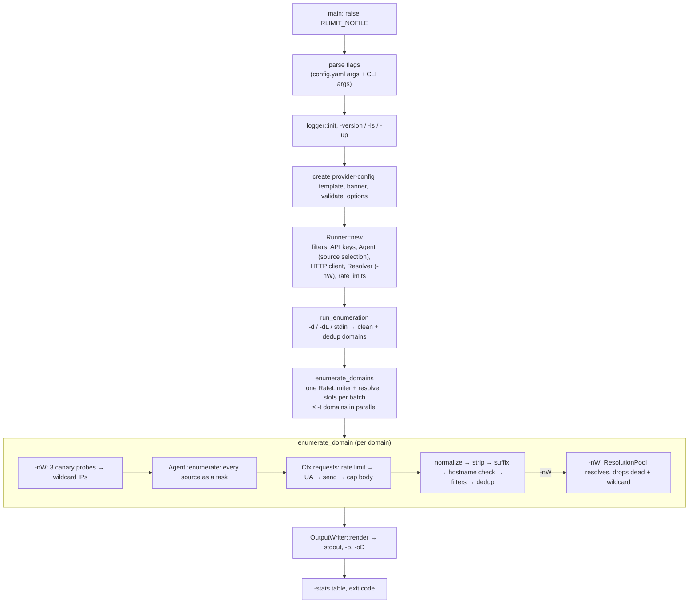

# Architecture

This document explains how rustradar is put together and why. Read it before
changing anything outside a single source file.

## 1. Module map

The modules mirror the Go packages described in [`plans/`](../plans/), so each
plan document maps to one Rust module.

| Plan | Go package | Rust module | Main files |
|---|---|---|---|
| `cmd.md` | `cmd/subfinder` | binary | `src/main.rs` |
| `runner.md` | `pkg/runner` | `rustradar::runner` | `options.rs`, `config.rs`, `mod.rs` (Runner, batch), `enumerate.rs`, `output.rs`, `stats.rs`, `util.rs`, `validate.rs`, `banner.rs` |
| `passive.md` | `pkg/passive` | `rustradar::passive` | `mod.rs` (selection, Agent), `limiter.rs` |
| `resolve.md` | `pkg/resolve` | `rustradar::resolve` | `client.rs` (Resolver), `pool.rs` (ResolutionPool) |
| `subscraping.md` | `pkg/subscraping` | `rustradar::subscraping` | `mod.rs` (Source trait), `context.rs` (Ctx, Request), `session.rs`, `extractor.rs`, `utils.rs`, `sources/*.rs` |
| (gologger) | external | `rustradar::logger` | `logger.rs` |

Dependencies point one way: `runner` → `passive` / `resolve` → `subscraping`.
`subscraping` knows nothing about the runner; `passive` only re-uses the
`RateLimiter` type inside `Session`.

## 2. Execution flow

Step by step:

1. **Bootstrap** (`main.rs`). Raise the soft open-file limit to the hard limit
   (`rlimit`), so hundreds of sockets do not fail with `EMFILE`.
2. **Flags** (`runner/options.rs`). `normalize_args` rewrites subfinder-style
   single-dash flags (`-dL`) to clap long flags (`--list`). The flag config
   file is turned into `--name=value` arguments and placed *before* the user's
   arguments; `args_override_self` makes the later (CLI) value win for scalar
   flags. List flags accumulate.
3. **Validation** (`runner/validate.rs`). Same rules as subfinder, plus a check
   that every `-rls` source exists.
4. **Runner construction** (`runner/mod.rs`). Compiles filters, loads keys
   (`config.rs`), selects sources (`passive::select_sources`), builds one
   shared `reqwest::Client`, the DNS resolver (only with `-nW`), and merges
   default and user rate limits.
5. **Batch dispatch** (`Runner::enumerate_domains`). Cleans and deduplicates
   input, opens `-o` (truncating it once), and runs up to `-t` domains at a
   time with `try_for_each_concurrent`. The first hard error stops the batch.
6. **Per domain** (`runner/enumerate.rs`). Wildcard probes (with `-nW`), then
   the passive fan-out, candidate pipeline and optional resolution (sections
   4 to 6). The domain's block is written to every output as soon as it
   finishes, so each domain's lines stay together.

## 3. Concurrency model

Everything runs on one multi-threaded tokio runtime.

| Level | Mechanism | Bound |
|---|---|---|
| Domains | `try_for_each_concurrent` | `-t` |
| Sources per domain | `JoinSet` task per source | number of selected sources |
| Requests per source | sequential inside the source, or `buffer_unordered` / `join_all` (github, driftnet) | source-specific |
| Results | bounded `mpsc` channel (1024) from sources to the collector | backpressure |
| DNS lookups | `Semaphore` shared by all domains (`Resolver::with_concurrency_limit`) | `-t` |
| Request pacing | `RateLimiter` shared by all domains | per-source budgets |

**Cancellation.** Rust futures stop when dropped. Each source runs inside
`tokio::time::timeout_at(deadline, source.run(&ctx))`, where the deadline is
`-max-time` after the domain started. When it fires, the source future
(including any pending HTTP request or rate-limit wait) is dropped and an
error "time limit reached" is recorded. Go needed explicit channel draining
to avoid goroutine leaks; here there is nothing to drain. Ctrl-C drops the
whole run from `main`.

**Stopping early.** `Ctx::emit` returns `false` when the receiver is gone or
the source reached `-max-results`; sources check it and return.

## 4. Passive fan-out (`passive::Agent`)

`Agent::enumerate(domain, client, limiter, options)`:

1. Builds one `Session` for the domain (HTTP client + extractor for that
   domain + rate limiter + limits).
2. For each selected source: if it needs a key and has none, records it as
   *skipped* and moves on. Otherwise spawns a task with its own `Ctx`
   (domain, keys, session, channel sender, stats counters).
3. Returns the receiving end of the result channel. It closes when all tasks
   finish.
4. When each task ends, its counters are added to the agent's totals, which
   `-stats` prints (summed over all domains).

A source returning `Err` is recorded as one error and logged as a warning; it
never fails the run.

## 5. Candidate pipeline (`runner/enumerate.rs`)

Every raw value from a source goes through, in order:

1. `normalize_subdomain`: lowercase, trim, drop one trailing dot.
2. `strip_patterns`: remove `*.`, `/`, bullets and `http(s)://` (same as
   subfinder's replacer). If the raw value contained `*.<host>`, the host is
   flagged `wildcard_certificate`.
3. **Suffix check**: must end with `.<domain>` (the apex itself is not a result).
4. **Hostname check** (`is_valid_hostname`): only `a-z 0-9 . - _`, no empty
   labels, label ≤ 63 and name ≤ 253 bytes. This blocks escape sequences and
   junk from untrusted providers. *(rustradar addition.)*
5. **Filters**: `-f/-filter-regex` drop, `-m/-match-regex` must match.
6. **Dedup**: first source wins the `source` field; every source is recorded
   for `-cs`; later wildcard flags are merged in.
7. New hosts trigger the result callback (passive mode) and are sent to the
   resolution pool (active mode).

## 6. Active resolution and wildcards (`resolve`)

`Resolver` wraps hickory's async resolver with the configured nameservers
(UDP, 2 attempts, IPv4 A records, no hosts file). NXDOMAIN or "no records"
is an empty answer, not an error.

**Wildcard detection** (`ResolutionPool::init_wildcards`): resolve three
random 20-character labels under the domain. If one does not resolve, the
domain is not wildcard (IPs from earlier probes are still kept, as in
subfinder). If all resolve, their IPs are sinkholes.

**Resolution** (`ResolutionPool::spawn`): a dispatcher task reads candidates
and resolves each in its own task, bounded by a per-domain semaphore (`-t`)
and the shared resolver slots. A host is dropped when it does not resolve or
when any of its IPs is a sinkhole. Results carry the first IP for `-oI`.

## 7. HTTP layer (`subscraping`)

* **Client** (`session::build_client`): one per run, pooled connections,
  `-timeout` for connect and total time, up to 10 redirects, optional proxy
  (`http`, `https`, `socks5`). Certificate validation is off, as in subfinder:
  several providers have broken chains and the data is validated anyway.
* **Requests** (`Ctx::get/post → Request`): every send waits on the rate
  limiter, counts a request, sets a random browser User-Agent, `Accept: */*`
  and `Accept-Language: en`, then applies the source's headers (which replace
  the defaults).
* **Status**: `send()`/`text()`/`decode()` treat anything but 200 as a
  `StatusError` (status, URL, body snippet). Sources that must look at the
  status use `send_raw()` or `status_of(&err)`.
* **Body cap**: `Session::read_body` stops after `-rsr` bytes of *decoded*
  body, which also limits decompression bombs.

## 8. Rate limiting (`passive/limiter.rs`)

Fixed-window budgets per source, shared by every domain in the batch:

* Limit for a source = its `-rls` value, else the built-in default
  (`DEFAULT_RATE_LIMITS`), else `-rl` per second, else unlimited.
* `wait(source)`: if the current window has passed, move the window start to
  the latest boundary (anchored to limiter creation, so idle time cannot be
  saved up into a burst) and refill. Take a token if available; otherwise
  sleep until the window ends and retry.
* The critical section is a `std::sync::Mutex` held for a few instructions;
  waiting happens outside the lock with `tokio::time::sleep`.

## 9. Output (`runner/output.rs`)

`OutputWriter::render` produces the whole block for one domain as a string;
`write_all` writes it to each sink under that sink's mutex, so concurrent
domains never interleave lines. Format precedence: `-oI` (with `-nW`), then
`-cs`, then plain. Hosts are sorted (`BTreeMap`).

## 10. Security measures

| Risk | Mitigation | Where |
|---|---|---|
| Cross-apex spoofing (`a.example.com.evil.org`) | match is dropped if the hostname continues | `extractor.rs` |
| Junk / escape sequences from providers | strict hostname validation before output | `runner/util.rs` |
| Huge bodies, decompression bombs | `-rsr` cap on decoded bytes | `session.rs` |
| API keys in logs (keys in query strings) | keys registered at load time and replaced by `[REDACTED]` in every log line | `logger.rs`, `config.rs` |
| SQL injection in crt.sh query | domain must be `[A-Za-z0-9._-]` before building the statement | `sources/crtsh.rs` |
| Key file readable by others | template created with mode 600 | `config.rs` |
| Runaway pagination | every paginating source has a page cap | `sources/*.rs` |

## 11. Error handling

* **Fatal** (exit 1): invalid flags, unreadable config or domain list,
  invalid regex, no sources selected, output file not writable.
* **Per source** (warning, run continues): network errors, non-200 status,
  bad JSON, quota messages, timeouts.
* **Per DNS lookup** (debug log): resolver errors drop that host.
* A broken stdout pipe (`| head`) exits 0 quietly. Ctrl-C exits 130.

## 12. Design decisions and differences from subfinder

| Topic | subfinder | rustradar | Why |
|---|---|---|---|
| Source plumbing | each source owns a goroutine, channel, stats, mutex | sources only implement `run(&Ctx)`; the agent handles tasks, stats, timeouts and skipping | much less boilerplate per source, fewer ways to get it wrong |
| Cancellation | context + channel draining | drop the future at the deadline | no leaks by construction |
| Output order | Go map order (random) | sorted per domain | reproducible diffs |
| `-o` file | opened in append mode | truncated once per run | rerunning does not duplicate lines |
| Duplicate input domains | enumerated twice | deduplicated | saves quota |
| Hostname validation | none after extraction | strict check | untrusted input |
| Statistics | last domain only | summed over the batch | meaningful for `-dL` |
| Flag config | goflags YAML merge | YAML → CLI arguments | one parser, simple precedence |
| Updates (`-up`) | self-update via updateutils | self-update from GitHub releases, SHA-256 verified | same UX, own release pipeline (`release.yml`) |
| `gitlab` source | present | not included (not in the plan's catalog) | can be added later |
| Quarantined sources (`reconcloud`, `riddler`, `threatminer`) | present, disabled | not included | offline / blocked upstream |
