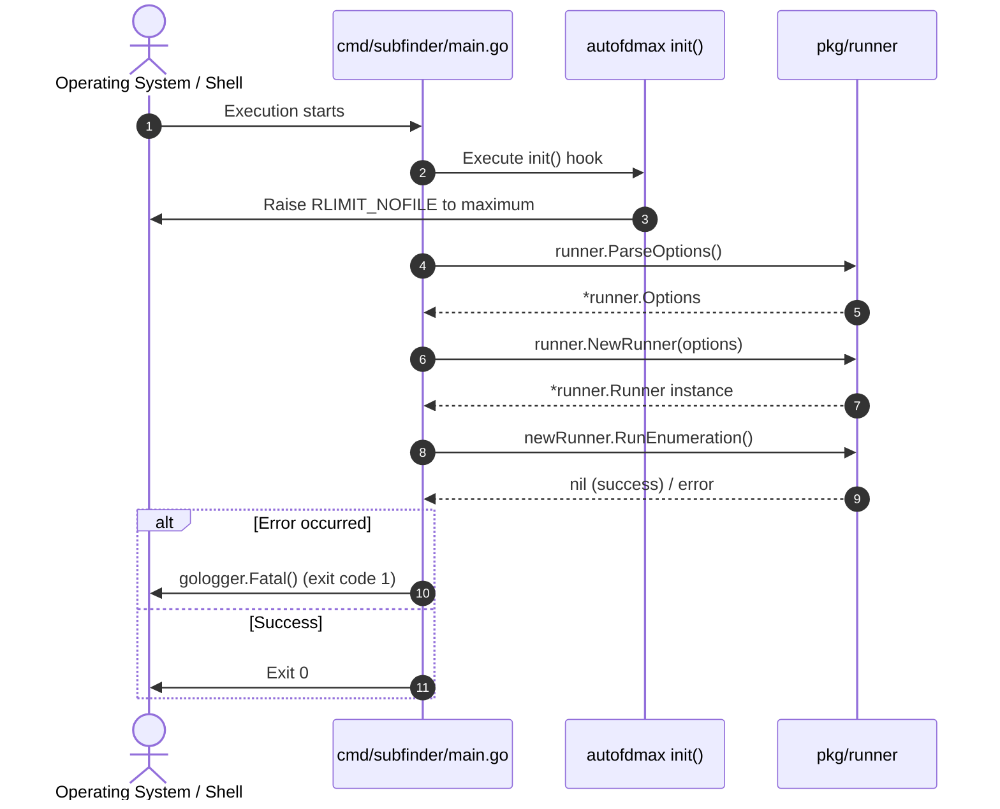

# Module Plan: `cmd/subfinder`

---

## 1. Module Overview & Purpose

The `cmd/subfinder` module represents the command-line interface (CLI) entrypoint of the Subfinder application. Its primary responsibilities are:
1. **Operating System File Descriptor Tuning**: Silently elevating system socket limits to prevent descriptor exhaustion during high-concurrency enumeration.
2. **Options Parsing & Ingestion**: Delegating flag parsing, environment variable binding, and configuration loading to `pkg/runner`.
3. **Runner Lifecycle Management**: Initializing the core enumeration runner and executing the target discovery workflow.
4. **Fatal Error Handling & Process Exit**: Capturing unrecoverable runtime errors and reporting them cleanly through structured logging.

---

## 2. File Structure

```
cmd/subfinder/
└── main.go       # Main application entrypoint
```

---

## 3. Complete Source Code: `cmd/subfinder/main.go`

```go
package main

import (
	"github.com/projectdiscovery/subfinder/v2/pkg/runner"
	// Attempts to increase the OS file descriptors - Fail silently
	_ "github.com/projectdiscovery/fdmax/autofdmax"
	"github.com/projectdiscovery/gologger"
)

func main() {
	// Parse the command line flags and read config files
	options := runner.ParseOptions()

	newRunner, err := runner.NewRunner(options)
	if err != nil {
		gologger.Fatal().Msgf("Could not create runner: %s\n", err)
	}

	err = newRunner.RunEnumeration()
	if err != nil {
		gologger.Fatal().Msgf("Could not run enumeration: %s\n", err)
	}
}
```

---

## 4. In-Depth Technical Walkthrough

### 4.1 Automated Socket & File Descriptor Elevation (`autofdmax`)
```go
// Attempts to increase the OS file descriptors - Fail silently
_ "github.com/projectdiscovery/fdmax/autofdmax"
```
* **Mechanism**: The blank import executes the package's `init()` function before `main()` starts.
* **Problem Solved**: High-throughput passive HTTP scraping and active DNS resolution spawn hundreds of concurrent TCP/UDP sockets. On POSIX systems (Linux/macOS), the default soft limit for open file descriptors (`RLIMIT_NOFILE`) is often set conservatively (e.g. 1024). Under heavy concurrency, this causes `socket: too many open files` (`EMFILE`) crashes.
* **Behavior**: `autofdmax` queries `syscall.Getrlimit(syscall.RLIMIT_NOFILE, &limit)` and invokes `syscall.Setrlimit` to increase the soft limit (`rlim_cur`) up to the hard ceiling (`rlim_max`). If the process lacks permissions (e.g. unprivileged container), it fails silently without crashing.

### 4.2 Configuration Parsing (`runner.ParseOptions()`)
```go
options := runner.ParseOptions()
```
* Delegates flag parsing to [`runner.ParseOptions()`](file:///home/pwnbox/Desktop/code_projects/sectools/subfinder/pkg/runner/options.go#L88).
* Ingests command-line arguments, merges `$CONFIG/subfinder/config.yaml` and `provider-config.yaml`, parses environment variables, configures logging levels, displays ASCII banners, and initiates asynchronous version checks.

### 4.3 Runner Construction (`runner.NewRunner(options)`)
```go
newRunner, err := runner.NewRunner(options)
if err != nil {
    gologger.Fatal().Msgf("Could not create runner: %s\n", err)
}
```
* Instantiates the [`Runner`](file:///home/pwnbox/Desktop/code_projects/sectools/subfinder/pkg/runner/runner.go#L30) struct.
* Compiles user-defined regular expressions and glob patterns (`-m`, `-f`, `-match-regex`, `-filter-regex`).
* Ingests provider credentials from YAML or environment variables.
* Initializes the passive scraping engine and the active DNS resolver pool (`dnsx`).

### 4.4 Enumeration Execution (`newRunner.RunEnumeration()`)
```go
err = newRunner.RunEnumeration()
if err != nil {
    gologger.Fatal().Msgf("Could not run enumeration: %s\n", err)
}
```
* Dispatches execution to [`runner.RunEnumeration()`](file:///home/pwnbox/Desktop/code_projects/sectools/subfinder/pkg/runner/runner.go#L97).
* Resolves whether inputs originate from single domains (`-d`), file lists (`-dL`), or `STDIN`.
* Runs enumeration to completion and exits with code 0 on success or terminates via `gologger.Fatal()` (exit code 1) on critical failure.

---

## 5. Working Process & Operational Flow


