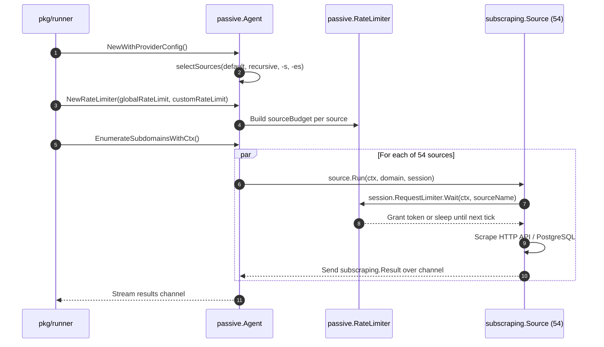

# Module Plan: `pkg/passive`

---

## 1. Module Overview & Purpose

The `pkg/passive` module is the coordinator of Subfinder's passive reconnaissance capabilities. Its core responsibilities include:
1. **Source Catalog Registry**: Maintaining the global inventory of all 54 built-in scraping sources ([`AllSources`](file:///home/pwnbox/Desktop/code_projects/sectools/subfinder/pkg/passive/sources.go#L71)).
2. **Dynamic Source Selection**: Filtering sources based on user inclusion (`-s`), exclusion (`-es`), default inclusion (`IsDefault()`), and recursive query capability (`HasRecursiveSupport()`).
3. **Cross-Domain Batch Rate Limiting**: Implementing a fixed-window token-bucket rate limiter ([`RateLimiter`](file:///home/pwnbox/Desktop/code_projects/sectools/subfinder/pkg/passive/limiter.go#L18)) shared across concurrent domain workers to guarantee upstream API compliance without quota bans.
4. **Concurrent Scraping Dispatch**: Spawning parallel goroutines per source for each target domain, managing timeouts, and safely draining channel results.
5. **Custom Plugin Serialization**: Providing a thread-safe mutex and gate wrapper ([`serializedSource`](file:///home/pwnbox/Desktop/code_projects/sectools/subfinder/pkg/passive/sources.go#L199)) for external community plugins.

---

## 2. File Structure

```
pkg/passive/
├── doc.go                  # Go package documentation
├── limiter.go              # Shared cross-domain batch token-bucket RateLimiter
├── passive.go              # Agent enumeration routines, With* options, statistics aggregation
├── sources.go              # Source catalog registry (AllSources), source selection, and custom serialization
├── connection_linux_test.go# Linux-specific network socket & FD tests
├── custom_sources_test.go  # Unit tests for custom/external plugin adapters
├── drain_test.go           # Channel draining and leak-avoidance tests
├── limiter_test.go         # Tests for rate-limiting windows and replenishment
├── ratelimit_test.go       # Multi-rate limiter concurrency tests
├── sources_test.go         # Generic tests across passive sources
├── sources_w_auth_test.go  # Tests for sources requiring API keys
├── sources_wo_auth_test.go # Tests for free/unauthenticated sources
└── workers_test.go         # Concurrency tests for passive agent workers
```

---

## 3. Core Data Structures & Source Code

### 3.1 `Agent` Struct ([`pkg/passive/sources.go`](file:///home/pwnbox/Desktop/code_projects/sectools/subfinder/pkg/passive/sources.go#L153-L155))

The `Agent` wraps the selected list of active sources for an enumeration run:

```go
type Agent struct {
	sources []subscraping.Source
}
```

---

### 3.2 Source Selection Logic: `selectSources` ([`pkg/passive/sources.go`](file:///home/pwnbox/Desktop/code_projects/sectools/subfinder/pkg/passive/sources.go#L252-L305))

Filters sources according to user arguments and source capabilities:

```go
func selectSources(available []subscraping.Source, byName map[string]subscraping.Source, sourceNames, excludedSourceNames []string, useAllSources, useSourcesSupportingRecurse bool) *Agent {
	sources := make(map[string]subscraping.Source, len(available))

	if useAllSources {
		maps.Copy(sources, byName)
	} else {
		if len(sourceNames) > 0 {
			for _, source := range sourceNames {
				if byName[source] == nil {
					gologger.Warning().Msgf("There is no source with the name: %s", source)
				} else {
					sources[source] = byName[source]
				}
			}
		} else {
			for _, currentSource := range available {
				if currentSource.IsDefault() {
					sources[currentSource.Name()] = currentSource
				}
			}
		}
	}

	if len(excludedSourceNames) > 0 {
		for _, sourceName := range excludedSourceNames {
			delete(sources, sourceName)
		}
	}

	if useSourcesSupportingRecurse {
		for sourceName, source := range sources {
			if !source.HasRecursiveSupport() {
				delete(sources, sourceName)
			}
		}
	}

	if len(sources) == 0 {
		gologger.Fatal().Msg("No sources selected for this search")
	}

	gologger.Debug().Msgf("Selected source(s) for this search: %s", strings.Join(slices.Sorted(maps.Keys(sources)), ", "))

	for _, currentSource := range sources {
		if warning, ok := sourceWarnings.Get(strings.ToLower(currentSource.Name())); ok {
			gologger.Warning().Msg(warning)
		}
	}

	return &Agent{sources: slices.Collect(maps.Values(sources))}
}
```

---

### 3.3 Passive Enumerator: `EnumerateSubdomainsWithCtx` ([`pkg/passive/passive.go`](file:///home/pwnbox/Desktop/code_projects/sectools/subfinder/pkg/passive/passive.go#L63-L135))

Spawns a goroutine for each source and multiplexes results into a single output channel:

```go
func (a *Agent) EnumerateSubdomainsWithCtx(ctx context.Context, domain string, proxy string, rateLimit int, timeout int, maxEnumTime time.Duration, options ...EnumerateOption) chan subscraping.Result {
	results := make(chan subscraping.Result)

	go func() {
		defer close(results)

		var enumerateOptions EnumerationOptions
		for _, enumerateOption := range options {
			enumerateOption(&enumerateOptions)
		}

		var multiRateLimiter *ratelimit.MultiLimiter
		var err error
		borrowedLegacy := false
		if limiter, ok := enumerateOptions.rateLimiter.(*RateLimiter); ok && limiter.legacy != nil {
			multiRateLimiter = limiter.legacy
			borrowedLegacy = true
		} else if enumerateOptions.rateLimiter == nil {
			multiRateLimiter, err = a.buildMultiRateLimiter(ctx, rateLimit, enumerateOptions.customRateLimiter)
		}
		if err != nil {
			results <- subscraping.Result{
				Type: subscraping.Error, Error: fmt.Errorf("could not init multi rate limiter for %s: %s", domain, err),
			}
			return
		}
		session, err := subscraping.NewSession(domain, proxy, multiRateLimiter, timeout)
		if err != nil {
			if !borrowedLegacy && multiRateLimiter != nil {
				multiRateLimiter.Stop()
			}
			results <- subscraping.Result{
				Type: subscraping.Error, Error: fmt.Errorf("could not init passive session for %s: %s", domain, err),
			}
			return
		}
		session.RequestLimiter = enumerateOptions.rateLimiter
		if borrowedLegacy {
			defer session.Client.CloseIdleConnections()
		} else {
			defer session.Close()
		}
		session.MaxResults = enumerateOptions.maxResults
		session.MaxResponseBodySize = enumerateOptions.maxResponseBodySize

		ctx, cancel := context.WithTimeout(ctx, maxEnumTime)

		wg := &sync.WaitGroup{}
		// Run each source in parallel on the target domain
		for _, runner := range a.sources {
			wg.Add(1)
			go func(source subscraping.Source) {
				defer wg.Done()
				ctxWithValue := context.WithValue(ctx, subscraping.CtxSourceArg, source.Name())
				sourceResults := source.Run(ctxWithValue, domain, session)
				for resp := range sourceResults {
					select {
					case <-ctx.Done():
						// stop forwarding but keep draining so the source goroutine
						// is never blocked on a send and can exit instead of leaking
						for range sourceResults {
						}
						return
					case results <- resp:
					}
				}
			}(runner)
		}
		wg.Wait()
		cancel()
	}()
	return results
}
```

---

### 3.4 Shared Cross-Domain Batch Rate Limiter ([`pkg/passive/limiter.go`](file:///home/pwnbox/Desktop/code_projects/sectools/subfinder/pkg/passive/limiter.go#L18-L148))

Enforces token bucket pacing across concurrent domain workers:

```go
type RateLimiter struct {
	sources       map[string]*sourceBudget
	legacy        *ratelimit.MultiLimiter
	legacySources map[string]bool
	stop          func() bool
}

type sourceBudget struct {
	mu               sync.Mutex
	limit, remaining uint
	period           time.Duration
	start            time.Time
}

func (l *RateLimiter) Wait(ctx context.Context, source string) error {
	if err := ctx.Err(); err != nil {
		return err
	}

	if l.legacySources[source] {
		if err := l.legacy.Take(source); err != nil {
			return err
		}
		return ctx.Err()
	}

	budget, ok := l.sources[source]
	if !ok {
		return fmt.Errorf("no rate limit configured for source %s", source)
	}

	for {
		if err := ctx.Err(); err != nil {
			return err
		}

		if budget == nil {
			return nil
		}

		budget.mu.Lock()
		now := time.Now()
		elapsed := now.Sub(budget.start)

		if elapsed >= budget.period {
			// Keep window boundaries anchored to batch creation even after idle time.
			budget.start = now.Add(-(elapsed % budget.period))
			budget.remaining = budget.limit
			elapsed = now.Sub(budget.start)
		}

		if budget.remaining > 0 {
			budget.remaining--
			budget.mu.Unlock()
			return nil
		}

		delay := budget.period - elapsed
		budget.mu.Unlock()
		timer := time.NewTimer(delay)

		select {
		case <-ctx.Done():
			timer.Stop()
			return ctx.Err()
		case <-timer.C:
		}
	}
}
```

---

## 4. Working Process Flow


