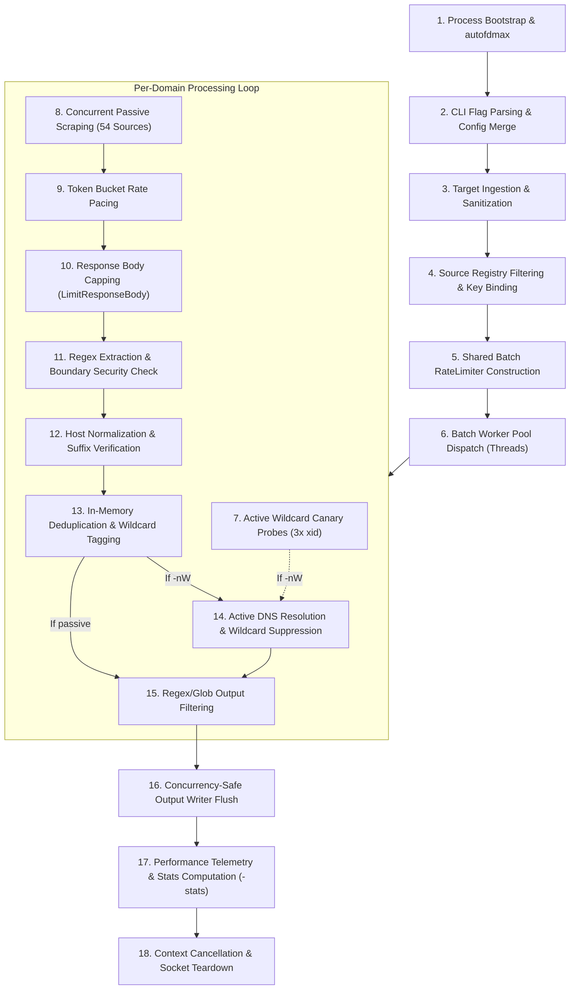

# Subfinder: Master Architecture, File Structures, Working Process & Commands Specification

---

## 1. Executive Overview & Product Vision

### 1.1 Tool Summary & Mission Statement
**Subfinder** (current core release: `v2.17.0`) is an enterprise-grade, high-throughput subdomain enumeration tool engineered by [ProjectDiscovery](https://projectdiscovery.io). Subfinder is designed with a singular, uncompromising mission: **fast, passive, stealthy, and deterministic subdomain discovery**.

Rather than utilizing brute-force DNS probing (which emits millions of noisy queries directly to authoritative nameservers), Subfinder targets curated, authoritative passive data sinks—such as Certificate Transparency (CT) logs, search engine indexes, public threat intelligence feeds, web archives, and passive DNS (pDNS) repositories. When deterministic validation is required, Subfinder incorporates an active resolution module equipped with canary-based wildcard mitigation.

### 1.2 Core Design Principles
* **Passive-First & Zero Target Footprint**: Discovers assets via third-party telemetry without interacting directly with target infrastructure during passive runs.
* **Extreme Concurrency & Non-Blocking Streams**: Leverages Go goroutines, non-blocking channel pipelines, and token-bucket rate limiters to scrape dozens of domains simultaneously across 54 sources in seconds.
* **Strict Upstream Compliance**: Honors upstream provider rate limits, pagination contracts, and API quotas via granular per-provider configuration.
* **Unix-Philosophy & Composable Integration**: Implements clean STDIN/STDOUT piping, structured JSONL outputs, and an importable Go SDK interface (`pkg/runner`, `pkg/passive`, `pkg/resolve`).

---

## 2. Master Module Index & Architecture Breakdown

Subfinder is structured into five core modules. Each module has its own dedicated plan specification containing full code implementations, internal algorithms, and module-specific data flows:

| Module Identifier | Directory | Plan Document | Primary Responsibilities |
| :--- | :--- | :--- | :--- |
| **`cmd`** | [`cmd/subfinder/`](file:///home/pwnbox/Desktop/code_projects/sectools/subfinder/cmd/subfinder) | [**`cmd.md`**](file:///home/pwnbox/Desktop/code_projects/sectools/subfinder/cmd.md) | Entrypoint; `autofdmax` file descriptor elevation; flag orchestration; exit handling. |
| **`runner`** | [`pkg/runner/`](file:///home/pwnbox/Desktop/code_projects/sectools/subfinder/pkg/runner) | [**`runner.md`**](file:///home/pwnbox/Desktop/code_projects/sectools/subfinder/runner.md) | Central orchestration; domain batching; deduplication; multi-format writer (`OutputWriter`). |
| **`passive`** | [`pkg/passive/`](file:///home/pwnbox/Desktop/code_projects/sectools/subfinder/pkg/passive) | [**`passive.md`**](file:///home/pwnbox/Desktop/code_projects/sectools/subfinder/passive.md) | Source catalog registry (54 sources); source filtering; batch cross-domain `RateLimiter`. |
| **`resolve`** | [`pkg/resolve/`](file:///home/pwnbox/Desktop/code_projects/sectools/subfinder/pkg/resolve) | [**`resolve.md`**](file:///home/pwnbox/Desktop/code_projects/sectools/subfinder/resolve.md) | Active DNS resolution (`dnsx`); 3x randomized `xid` canary probes; wildcard sinkhole elimination. |
| **`subscraping`** | [`pkg/subscraping/`](file:///home/pwnbox/Desktop/code_projects/sectools/subfinder/pkg/subscraping) | [**`subscraping.md`**](file:///home/pwnbox/Desktop/code_projects/sectools/subfinder/subscraping.md) | `Source` interface; `Session` HTTP client; `LimitResponseBody` safety; `RegexSubdomainExtractor`. |

---

## 3. Complete Repository File Structure

Below is the complete file and directory layout of the Subfinder repository:

```
subfinder/
├── cmd/
│   └── subfinder/
│       └── main.go                 # CLI Entrypoint; initializes autofdmax, parses options, triggers runner
├── pkg/
│   ├── passive/                    # Passive enumeration orchestration package
│   │   ├── connection_linux_test.go# Linux-specific network socket & FD tests
│   │   ├── custom_sources_test.go  # Unit tests for custom/external plugin adapters
│   │   ├── doc.go                  # Package documentation
│   │   ├── drain_test.go           # Channel draining and leak-avoidance tests
│   │   ├── limiter.go              # Shared cross-domain batch token-bucket RateLimiter
│   │   ├── limiter_test.go         # Tests for rate-limiting windows and replenishment
│   │   ├── passive.go              # Agent enumeration routines, With* options, statistics aggregation
│   │   ├── ratelimit_test.go       # Multi-rate limiter concurrency tests
│   │   ├── sources.go              # Source registry (AllSources), source selection, and custom serialization
│   │   ├── sources_test.go         # Generic tests across passive sources
│   │   ├── sources_w_auth_test.go  # Tests for sources requiring API keys
│   │   ├── sources_wo_auth_test.go # Tests for free/unauthenticated sources
│   │   └── workers_test.go         # Concurrency tests for passive agent workers
│   ├── resolve/                    # Active DNS resolution & wildcard elimination engine
│   │   ├── client.go               # Resolver struct, DefaultResolvers, lookup concurrency throttling
│   │   ├── concurrency_test.go     # Tests for concurrent DNS lookups and lookupSlots
│   │   ├── doc.go                  # Package documentation
│   │   └── resolve.go              # ResolutionPool, canary xid probe generation, wildcard suppression
│   ├── runner/                     # Central application orchestration engine
│   │   ├── banners.go              # ASCII art banner, version metadata, update check callback
│   │   ├── concurrency_active_test.go # Stress tests for active DNS resolution concurrency
│   │   ├── concurrency_test.go     # Concurrency and race-detection tests for runner pipelines
│   │   ├── config.go               # YAML provider configuration creation and unmarshaling
│   │   ├── config_concurrency_test.go # Multi-threaded config access tests
│   │   ├── doc.go                  # Package documentation
│   │   ├── enumerate.go            # Single-domain enumeration logic, deduplication, wildcard certificate logic
│   │   ├── enumerate_test.go       # Tests for domain enumeration workflows
│   │   ├── filter_test.go          # Tests for glob and regex match/filter compilation
│   │   ├── initialize.go           # Runner initialization (resolver client, agent creation, key injection)
│   │   ├── options.go              # CLI flag declarations, Options struct, default rate limits, listSources
│   │   ├── outputter.go            # Buffered OutputWriter (plain text, JSONL, source attribution, IP mapping)
│   │   ├── runner.go               # Runner struct, EnumerateMultipleDomainsWithCtx batch dispatcher
│   │   ├── stats.go                # Formatting and display of per-source performance metrics
│   │   ├── util.go                 # Preprocessing, normalization, domain cleaning helpers
│   │   ├── util_test.go            # Unit tests for domain normalization and URL stripping
│   │   └── validate.go             # Flag sanity validation and regex compilation
│   ├── subscraping/                # Scraper interfaces, HTTP session primitives, and source implementations
│   │   ├── agent.go                # HTTP Client wrapper, random User-Agent injection, LimitResponseBody
│   │   ├── agent_connection_test.go# Tests for HTTP transport connection pooling
│   │   ├── agent_test.go           # Unit tests for session requests and headers
│   │   ├── discard_test.go         # Tests for HTTP response body discarding
│   │   ├── doc.go                  # Package documentation
│   │   ├── extractor.go            # RegexSubdomainExtractor, boundary check hostnameContinues
│   │   ├── extractor_test.go       # Tests for subdomain extraction and trailing boundary security
│   │   ├── sources/                # 54 individual source scrapers
│   │   │   ├── alienvault/         # AlienVault OTX API integration
│   │   │   ├── anubis/             # AnubisDB scraper
│   │   │   ├── bevigil/            # BeVigil OSINT API
│   │   │   ├── bufferover/         # BufferOver TLS/DNS scraper
│   │   │   ├── builtwith/          # BuiltWith relationships scraper
│   │   │   ├── c99/                # C99 Subdomain API
│   │   │   ├── censys/             # Censys Search API integration
│   │   │   ├── certspotter/        # SSLMate CertSpotter CT log API
│   │   │   ├── chaos/              # ProjectDiscovery Chaos API
│   │   │   ├── chinaz/             # ChinaZ subdomain API
│   │   │   ├── commoncrawl/        # CommonCrawl CDX archive index scraper
│   │   │   ├── crtname/            # CrtName SAN extractor
│   │   │   ├── crtsh/              # crt.sh Direct PostgreSQL query + HTTP fallback
│   │   │   ├── digitalyama/        # DigitalYama API
│   │   │   ├── digitorus/          # Digitorus certificate scraper
│   │   │   ├── dnsdb/              # Farsight DNSDB API
│   │   │   ├── dnsdumpster/        # DNSDumpster scraper
│   │   │   ├── dnsrepo/            # DNSRepo API
│   │   │   ├── domainsproject/     # DomainsProject dataset API
│   │   │   ├── driftnet/           # Driftnet passive recon feed
│   │   │   ├── fofa/               # FOFA search API (base64 queries)
│   │   │   ├── fullhunt/           # FullHunt ASM API
│   │   │   ├── github/             # GitHub Code Search API
│   │   │   ├── hackertarget/       # HackerTarget API
│   │   │   ├── hudsonrock/         # Hudson Rock cybercrime intel API
│   │   │   ├── intelx/             # Intelligence X search API
│   │   │   ├── leakix/             # LeakIX leak intelligence API
│   │   │   ├── merklemap/          # Merklemap CT search API
│   │   │   ├── netlas/             # Netlas attack surface API
│   │   │   ├── onyphe/             # Onyphe cyber recon API
│   │   │   ├── profundis/          # Profundis API
│   │   │   ├── pugrecon/           # PugRecon API
│   │   │   ├── quake/              # 360 Quake search API
│   │   │   ├── rapiddns/           # RapidDNS HTML scraper
│   │   │   ├── reconcloud/         # [Quarantined] Cloudflare protected
│   │   │   ├── reconeer/           # Reconeer API
│   │   │   ├── redhuntlabs/        # RedHunt Labs Recon API
│   │   │   ├── riddler/            # [Quarantined] CloudFront protected
│   │   │   ├── robtex/             # Robtex forward DNS API
│   │   │   ├── rsecloud/           # RSECloud API
│   │   │   ├── scanmalware/        # ScanMalware scraper
│   │   │   ├── securitytrails/     # SecurityTrails historical DNS API
│   │   │   ├── shodan/             # Shodan DNS API
│   │   │   ├── shodanct/           # Shodan Certificate Stream API
│   │   │   ├── sitedossier/        # SiteDossier web scraper
│   │   │   ├── subdomaincenter/    # SubdomainCenter API
│   │   │   ├── submd/              # SubMD API
│   │   │   ├── thc/                # THC database query
│   │   │   ├── threatbook/         # ThreatBook threat intelligence API
│   │   │   ├── threatcrowd/        # ThreatCrowd historical graph API
│   │   │   ├── threatminer/        # [Quarantined] API offline
│   │   │   ├── urlscan/            # URLScan search API
│   │   │   ├── virustotal/         # VirusTotal v3 cursor paginating API
│   │   │   ├── waybackarchive/     # Wayback Machine CDX API
│   │   │   ├── whoisxmlapi/        # WhoisXMLAPI subdomain API
│   │   │   ├── windvane/           # Windvane OSINT API
│   │   │   └── zoomeyeapi/         # ZoomEye search API
│   │   ├── types.go                # Source interface, Session struct, KeyRequirement, Result
│   │   └── utils.go                # PickRandom API key helper
│   └── testutils/
│       └── integration.go          # Live integration test framework
├── cmd.md                          # Detailed plan and code for cmd/subfinder
├── runner.md                       # Detailed plan and code for pkg/runner
├── passive.md                      # Detailed plan and code for pkg/passive
├── resolve.md                      # Detailed plan and code for pkg/resolve
├── subscraping.md                  # Detailed plan and code for pkg/subscraping
├── examples/
│   └── main.go                     # Go SDK library usage example
├── static/
│   ├── subfinder-logo.png          # Project banner logo
│   └── subfinder-run.png           # CLI execution screenshot
├── .github/
│   └── workflows/                  # CI/CD GitHub Actions
│       ├── build-test.yml          # Multi-OS test & compile matrix
│       ├── codeql-analysis.yml     # CodeQL security scanning
│       ├── compat-checks.yml       # Interface compatibility verification
│       ├── dep-auto-merge.yml      # Automated Dependabot PR merge
│       ├── release.yml             # GoReleaser multi-arch production binary & Docker release
│       └── release-test.yml        # Dry-run release testing
├── Dockerfile                      # Official lightweight scratch-based container definition
├── Makefile                        # Build, test, tidy, and static binary recipes
├── go.mod                          # Go module dependencies declaration
├── go.sum                          # Cryptographic checksums of direct & transitive dependencies
├── .goreleaser.yml                 # Cross-platform release packaging automation
├── DISCLAIMER.md                   # Legal and ethical usage guidelines
├── LICENSE.md                      # MIT Open Source License
└── THANKS.md                       # Open-source community contributor acknowledgments
```

---

## 4. End-to-End Working Process & Internal Execution Engine

The following diagram illustrates the complete, step-by-step internal execution lifecycle:



### Chronological Execution Steps

1. **Bootstrap & Tuning**: `_ "github.com/projectdiscovery/fdmax/autofdmax"` elevates the POSIX soft file descriptor limit (`RLIMIT_NOFILE`) to the hard ceiling to handle thousands of open sockets.
2. **Configuration Ingestion**: Ingests CLI flags via `goflags`, reads `$CONFIG/subfinder/config.yaml`, creates or loads `provider-config.yaml`, and maps environment variables (`${SOURCE}_API_KEY`).
3. **Domain Preprocessing**: Strips whitespace, schemes (`http://`, `https://`), URL paths/queries (`/?#`), bullet points, and wildcard prefixes (`*.`), normalizing domains to clean apex hostnames.
4. **Source Registration & Selection**: Filters the 54 active sources based on `-s`, `-es`, `-all`, and `-recursive`.
5. **Shared Batch Rate Limiter**: Instantiates a centralized `RateLimiter` managing fixed-window token buckets across all domains.
6. **Multi-Domain Dispatch**: Spawns a worker pool bounded by `Options.Threads` to process target domains concurrently.
7. **Active Canary Probes (if `-nW` / `-active`)**: Generates 3 randomized `xid` canary probes (`cb4j...<domain>`). If resolved, the returned IPs are cached as wildcard sinkholes.
8. **Concurrent Passive Scraping**: For each domain, spawns dedicated goroutines for each selected source. Rotates randomized User-Agents via `uarand`. For `crtsh`, queries PostgreSQL directly over port 5432 with HTTP fallback.
9. **Token Pacing**: Central `RequestLimiter.Wait()` throttles outbound requests according to per-provider rules.
10. **Memory Safety Capping**: `LimitResponseBody` wraps incoming HTTP responses with `io.LimitReader` to protect against unbounded bodies or decompression bombs.
11. **Boundary-Safe Regex Extraction**: Extracts candidates using `(?i)[a-zA-Z0-9\*_.-]+\.<domain>` and enforces `hostnameContinues` to prevent malicious cross-apex spoofing.
12. **Deduplication & Wildcard Tagging**: Unique in-memory maps record sources and tag wildcard certificate prefixes.
13. **Active DNS Resolution**: Resolves candidate hosts via `dnsx` and discards any host matching the cached wildcard sinkhole IPs.
14. **Filter & Match Evaluation**: Evaluates glob patterns (`-m`, `-f`) and regular expressions (`-match-regex`, `-filter-regex`).
15. **Output Writing & Telemetry**: Serializes results to stdout, text files (`-o`), per-domain directories (`-oD`), or JSONL (`-oJ`), and outputs per-source stats table if `-stats` is enabled.

---

## 5. Comprehensive Commands & CLI Usage Reference

### 5.1 Build, Installation & Container Recipes

```bash
# 1. Install latest stable binary via Go
go install -v github.com/projectdiscovery/subfinder/v2/cmd/subfinder@latest

# 2. Build from local repository source
git clone https://github.com/projectdiscovery/subfinder.git
cd subfinder
make build
# Binary is generated at ./subfinder

# 3. Build static binary using Makefile
make all

# 4. Run test suite with race condition detection
go test -v -race ./pkg/...

# 5. Build official Docker container
docker build -t projectdiscovery/subfinder:local .

# 6. Run container with mounted host directory for outputs
docker run --rm -it -v $(pwd):/data projectdiscovery/subfinder:local -d example.com -o /data/results.txt
```

---

### 5.2 Complete CLI Flag Reference

#### Input Flags
| Flag | Full Name | Type | Description |
| :--- | :--- | :--- | :--- |
| `-d` | `-domain` | string slice | Target apex domain(s) to discover subdomains for (repeatable). |
| `-dL` | `-list` | string | File path containing a list of target domains (one per line). |

#### Source Selection Flags
| Flag | Full Name | Type | Description |
| :--- | :--- | :--- | :--- |
| `-s` | `-sources` | string slice | Comma-separated list of sources to run exclusively (e.g. `-s crtsh,github,virustotal`). |
| `-es` | `-exclude-sources`| string slice | Comma-separated list of sources to exclude from the run (e.g. `-es alienvault,zoomeyeapi`). |
| `-all` | `-all` | boolean | Enable all sources, including slow search scrapers (CommonCrawl, Wayback, Archive). |
| `-recursive` | `-recursive` | boolean | Run only sources supporting recursive subdomain queries. |

#### Filtering & Matching Flags
| Flag | Full Name | Type | Description |
| :--- | :--- | :--- | :--- |
| `-m` | `-match` | string slice | Subdomain string or glob pattern to match (e.g. `-m api.*,staging.*` or path to file). |
| `-f` | `-filter` | string slice | Subdomain string or glob pattern to discard (e.g. `-f *.internal,*.corp`). |
| `-match-regex` | `-match-regex` | string slice | Go regular expression (or file of regexes) that subdomains must match to be output. |
| `-filter-regex`| `-filter-regex`| string slice | Go regular expression (or file of regexes) to suppress matching subdomains. |

#### Rate-Limiting & Concurrency Flags
| Flag | Full Name | Type | Description |
| :--- | :--- | :--- | :--- |
| `-rl` | `-rate-limit` | int | Global maximum HTTP requests per second across all sources. |
| `-rls` | `-rate-limits` | map | Granular provider rate limits (e.g. `-rls "hackertarget=10/s,virustotal=4/m,github=80/m"`). |
| `-t` | `-threads` | int | Number of concurrent goroutines for multi-domain enumeration and active DNS (default: `10`). |

#### Active DNS Resolution & Wildcard Flags
| Flag | Full Name | Type | Description |
| :--- | :--- | :--- | :--- |
| `-nW` | `-active` | boolean | Enable active DNS resolution and canary-based wildcard elimination. |
| `-oI` | `-ip` | boolean | Include resolved IP address in output (requires `-active` / `-nW`). |
| `-r` | `-resolvers` | string slice | Comma-separated list of custom DNS resolver IP:port pairs (e.g. `-r 1.1.1.1:53,8.8.8.8:53`). |
| `-rL` | `-rlist` | string | File path containing custom DNS resolvers (one per line). |
| `-ei` | `-exclude-ip` | boolean | Exclude raw IP addresses mistakenly present in the input domain list. |

#### Output & Formatting Flags
| Flag | Full Name | Type | Description |
| :--- | :--- | :--- | :--- |
| `-o` | `-output` | string | File path to write discovered results to. |
| `-oJ` | `-json` | boolean | Write output formatted as structured JSON Lines (JSONL). |
| `-oD` | `-output-dir` | string | Directory path to output individual `<domain>.txt` files (used with `-dL`). |
| `-cs` | `-collect-sources`| boolean | Collect and display all observing sources for each subdomain in JSON (`-oJ` only). |
| `-silent` | `-silent` | boolean | Suppress banner, info, and warning logs; emit only clean subdomain names. |
| `-nc` | `-no-color` | boolean | Disable ANSI terminal color codes in output. |

#### Configuration & Provider Flags
| Flag | Full Name | Type | Description |
| :--- | :--- | :--- | :--- |
| `-config` | `-config` | string | Path to custom YAML configuration file (default: `$CONFIG/subfinder/config.yaml`). |
| `-pc` | `-provider-config`| string | Path to provider API configuration file (default: `$CONFIG/subfinder/provider-config.yaml`). |
| `-proxy` | `-proxy` | string | HTTP proxy URL for all outbound source requests (e.g. `-proxy http://127.0.0.1:8080`). |

#### Optimization & Safety Flags
| Flag | Full Name | Type | Description |
| :--- | :--- | :--- | :--- |
| `-timeout` | `-timeout` | int | Timeout in seconds for individual source HTTP requests (default: `30`). |
| `-max-time` | `-max-time` | int | Global timeout in minutes to wait for domain enumeration results (default: `10`). |
| `-mr` | `-max-results` | int | Per-source result limit to conserve API quotas on paginating sources (0 = unlimited). |
| `-rsr` | `-response-size-read`| int | Maximum bytes to read from passive source HTTP response bodies (0 = unlimited). |

#### Debugging & Diagnostic Flags
| Flag | Full Name | Type | Description |
| :--- | :--- | :--- | :--- |
| `-v` | `-verbose` | boolean | Enable verbose logging displaying real-time discovery events per source. |
| `-version` | `-version` | boolean | Print Subfinder binary version and configuration directory, then exit. |
| `-ls` | `-list-sources` | boolean | List all 54 registered sources with key requirement flags (`-oJ` emits JSON). |
| `-stats` | `-stats` | boolean | Report per-source execution statistics (duration, results, requests, errors). |
| `-up` | `-update` | callback | Update Subfinder to the latest official release version. |
| `-duc` | `-disable-update-check`| boolean | Disable automated GitHub release update checking. |

---

### 5.3 Copy-Pasteable Real-World Recipes

#### Recipe 1: Basic Stealth Passive Enumeration
```bash
subfinder -d example.com -o example_subs.txt
```

#### Recipe 2: Maximum Depth (All Sources + Strict Body Size Cap)
```bash
subfinder -d example.com -all -rsr 10485760 -o example_all.txt
```

#### Recipe 3: Active Resolution with Wildcard Elimination and IP Output
```bash
subfinder -d example.com -nW -oI -o example_active_resolved.txt
```

#### Recipe 4: Granular Rate-Limiting for Sensitive Provider Quotas
```bash
subfinder -d example.com \
  -rl 20 \
  -rls "hackertarget=2/s,virustotal=4/m,github=80/m,securitytrails=1/s" \
  -o example_ratelimited.txt
```

#### Recipe 5: Batch Multi-Target Discovery with Per-Domain Output Directory
```bash
subfinder -dL targets.txt -t 25 -oD ./recon_results/ -oJ -cs
```

#### Recipe 6: Regex-Filtered Target Discovery
Extract only production or API subdomains while filtering out staging/dev environments:
```bash
subfinder -d example.com \
  -match-regex '^(api|prod|auth|vpn|portal)[0-9]{0,2}\.' \
  -filter-regex '(dev|staging|test|qa|demo)' \
  -o production_endpoints.txt
```

#### Recipe 7: Curated Public Resolvers with Upstream Corporate Proxy
```bash
subfinder -d example.com -nW \
  -r 1.1.1.1:53,8.8.8.8:53,9.9.9.9:53 \
  -proxy http://corp-proxy.internal:3128 \
  -o proxy_resolved.txt
```

#### Recipe 8: Full Diagnostic Telemetry Run
```bash
subfinder -d example.com -stats -v -o example_telemetry.txt
```

---

### 5.4 Advanced Security Chaining Pipelines

#### Pipeline 1: Subdomain Discovery ➔ Live Web Asset Filtering (`httpx`)
```bash
subfinder -d example.com -silent | httpx -silent -title -status-code -tech-detect -o live_web_assets.txt
```

#### Pipeline 2: Subdomain Discovery ➔ Port Scanning (`naabu`) ➔ Vulnerability Scanning (`nuclei`)
```bash
subfinder -d example.com -silent | \
  naabu -silent -p 80,443,8080,8443,9000 | \
  httpx -silent | \
  nuclei -t cves/ -severity critical,high -o vulnerabilities.txt
```

#### Pipeline 3: Multi-Domain Enumeration ➔ Deduplication (`anew`) ➔ Active DNS Validation (`dnsx`)
```bash
cat domains.txt | \
  subfinder -silent | \
  anew subdomains_inventory.txt | \
  dnsx -silent -a -resp -o resolved_inventory.txt
```

---

## 6. Provider Configuration & Authentication

### 6.1 Configuration File Format (`provider-config.yaml`)
Subfinder loads API keys from `$HOME/.config/subfinder/provider-config.yaml` (or custom path via `-pc` / `SUBFINDER_PROVIDER_CONFIG`). Multiple keys per provider can be supplied as a YAML array; Subfinder randomly selects between them to distribute request quotas.

```yaml
# ~/.config/subfinder/provider-config.yaml
alienvault:
  - "otx_api_key_here"
bevigil:
  - "bevigil_api_key_here"
bufferover:
  - "bufferover_api_key_here"
builtwith:
  - "builtwith_api_key_here"
c99:
  - "c99_api_key_here"
censys:
  - "censys_id:censys_secret"
certspotter:
  - "certspotter_token_here"
chaos:
  - "projectdiscovery_chaos_key"
chinaz:
  - "chinaz_api_key"
digitalyama:
  - "digitalyama_api_key"
dnsdb:
  - "dnsdb_api_key"
dnsdumpster:
  - "dnsdumpster_api_key"
dnsrepo:
  - "dnsrepo_api_key"
domainsproject:
  - "domainsproject_api_key"
driftnet:
  - "driftnet_api_key"
fofa:
  - "user@example.com:fofa_api_key"
fullhunt:
  - "fullhunt_api_key"
github:
  - "ghp_personal_access_token_1"
  - "ghp_personal_access_token_2"
hackertarget:
  - "hackertarget_api_key"
intelx:
  - "intelx_api_key"
leakix:
  - "leakix_api_key"
merklemap:
  - "merklemap_api_key"
netlas:
  - "netlas_api_key"
onyphe:
  - "onyphe_api_key"
profundis:
  - "profundis_api_key"
pugrecon:
  - "pugrecon_api_key"
quake:
  - "360_quake_api_key"
reconeer:
  - "reconeer_api_key"
redhuntlabs:
  - "redhuntlabs_api_key"
robtex:
  - "robtex_api_key"
rsecloud:
  - "rsecloud_api_key"
securitytrails:
  - "securitytrails_api_key"
shodan:
  - "shodan_api_key"
subdomaincenter:
  - "subdomaincenter_api_key"
submd:
  - "submd_api_key"
threatbook:
  - "threatbook_api_key"
urlscan:
  - "urlscan_api_key"
virustotal:
  - "virustotal_v3_api_key"
whoisxmlapi:
  - "whoisxmlapi_api_key"
windvane:
  - "windvane_api_key"
zoomeyeapi:
  - "zoomeye_api_key"
```

### 6.2 Environment Variable Authentication
Alternatively, API keys can be passed as environment variables using the format `<SOURCE>_API_KEY`:

```bash
export GITHUB_API_KEY="ghp_xxxxxxxxxxxx"
export VIRUSTOTAL_API_KEY="xxxxxxxxxxxx"
export SHODAN_API_KEY="xxxxxxxxxxxx"
export SECURITYTRAILS_API_KEY="xxxxxxxxxxxx"
export CHAOS_API_KEY="xxxxxxxxxxxx"

subfinder -d example.com -o results.txt
```

---

## 7. Comprehensive Passive Sources Catalog (54 Sources)

| # | Source Identifier | Category | Key Requirement | Default Run | Recursive | Config Key / Env Var | Implementation Details |
| :---: | :--- | :--- | :---: | :---: | :---: | :--- | :--- |
| 1 | `alienvault` | Threat Intel | Required | Yes | Yes | `alienvault` / `ALIENVAULT_API_KEY` | AlienVault OTX API |
| 2 | `anubis` | Search / Recon | None | Yes | No | None | Public OSINT aggregator |
| 3 | `bevigil` | Mobile OSINT | Required | Yes | No | `bevigil` / `BEVIGIL_API_KEY` | Cloud mobile app OSINT |
| 4 | `bufferover` | DNS Aggregator | Required | Yes | Yes | `bufferover` / `BUFFEROVER_API_KEY` | Rapid TLS/DNS datasets |
| 5 | `builtwith` | Tech Profiler | Required | Yes | No | `builtwith` / `BUILTWITH_API_KEY` | Relationship extraction |
| 6 | `c99` | Threat Intel | Required | Yes | No | `c99` / `C99_API_KEY` | Subdomain API |
| 7 | `censys` | Internet Scanner | Required | Yes | No | `censys` / `CENSYS_API_KEY` | Requires `ID:Secret` format |
| 8 | `certspotter` | CT Logs | Required | Yes | Yes | `certspotter` / `CERTSPOTTER_API_KEY` | SSLMate CT Monitor API |
| 9 | `chaos` | Bug Bounty Intel | Required | Yes | No | `chaos` / `CHAOS_API_KEY` | ProjectDiscovery dataset |
| 10 | `chinaz` | Search / Alexa | Required | Yes | No | `chinaz` / `CHINAZ_API_KEY` | ChinaZ Subdomain API |
| 11 | `commoncrawl` | Web Archives | None | No (`-all`) | No | None | CDX index query (slow) |
| 12 | `crtname` | CT Logs | Optional | Yes | No | `crtname` / `CRTNAME_API_KEY` | Certificate SAN extractor |
| 13 | `crtsh` | CT Logs | None | Yes | Yes | None | **Direct PostgreSQL + HTTP fallback** |
| 14 | `digitalyama` | DNS Database | Required | Yes | No | `digitalyama` / `DIGITALYAMA_API_KEY` | DigitalYama API |
| 15 | `digitorus` | Certificate Audit| None | Yes | Yes | None | Certificate audit scraper |
| 16 | `dnsdb` | Passive DNS | Required | No (`-all`) | Yes | `dnsdb` / `DNSDB_API_KEY` | Farsight Security pDNS |
| 17 | `dnsdumpster` | DNS Recon | Required | Yes | No | `dnsdumpster` / `DNSDUMPSTER_API_KEY` | HackerTarget DNSDumpster v2 |
| 18 | `dnsrepo` | DNS Database | Required | Yes | No | `dnsrepo` / `DNSREPO_API_KEY` | DNSRepo API scraper |
| 19 | `domainsproject`| Domain Database| Required | Yes | No | `domainsproject` / `DOMAINSPROJECT_API_KEY` | Internet domain database |
| 20 | `driftnet` | Passive Recon | Required | Yes | Yes | `driftnet` / `DRIFTNET_API_KEY` | Driftnet network feed |
| 21 | `fofa` | Cyberspace Search | Required | Yes | No | `fofa` / `FOFA_API_KEY` | Base64 search queries |
| 22 | `fullhunt` | ASM Platform | Required | Yes | No | `fullhunt` / `FULLHUNT_API_KEY` | FullHunt REST API |
| 23 | `github` | Code Platform | Required | No (`-all`) | No | `github` / `GITHUB_API_KEY` | Code search API (83/m limit) |
| 24 | `hackertarget` | Network Tools | Optional | Yes | Yes | `hackertarget` / `HACKERTARGET_API_KEY` | Free tier limited to 2 req/s |
| 25 | `hudsonrock` | Cybercrime Intel | None | No (`-all`) | No | None | Infostealer intelligence database |
| 26 | `intelx` | Intelligence X | Required | Yes | No | `intelx` / `INTELX_API_KEY` | Polling search API |
| 27 | `leakix` | Leak Detection | Required | Yes | Yes | `leakix` / `LEAKIX_API_KEY` | LeakIX API |
| 28 | `merklemap` | CT Engine | Required | No (`-all`) | Yes | `merklemap` / `MERKLEMAP_API_KEY` | Merkle tree certificates |
| 29 | `netlas` | Attack Surface | Required | No (`-all`) | No | `netlas` / `NETLAS_API_KEY` | Netlas search API |
| 30 | `onyphe` | Cyber Recon | Required | Yes | No | `onyphe` / `ONYPHE_API_KEY` | Onyphe discovery endpoints |
| 31 | `profundis` | Threat Intel | Required | Yes | No | `profundis` / `PROFUNDIS_API_KEY` | Profundis API |
| 32 | `pugrecon` | OSINT Aggregator| Required | No (`-all`) | No | `pugrecon` / `PUGRECON_API_KEY` | PugRecon endpoints |
| 33 | `quake` | 360 Cyberspace | Required | Yes | No | `quake` / `QUAKE_API_KEY` | 360 Quake Search API |
| 34 | `rapiddns` | DNS Aggregator | None | No (`-all`) | No | None | Fast HTML table parsing |
| 35 | `reconeer` | Recon Database | Optional | Yes | No | `reconeer` / `RECONEER_API_KEY` | Recon database queries |
| 36 | `redhuntlabs` | ASM Platform | Required | Yes | No | `redhuntlabs` / `REDHUNTLABS_API_KEY` | RedHunt Labs Recon API |
| 37 | `robtex` | IP / DNS Intel | Required | Yes | No | `robtex` / `ROBTEX_API_KEY` | Robtex forward DNS API |
| 38 | `rsecloud` | Cloud Assets | Required | Yes | No | `rsecloud` / `RSECLOUD_API_KEY` | RSECloud API |
| 39 | `scanmalware` | Threat Intel | None | Yes | Yes | None | Free threat scraper |
| 40 | `securitytrails`| Passive DNS | Required | Yes | Yes | `securitytrails` / `SECURITYTRAILS_API_KEY` | Historical DNS records |
| 41 | `shodan` | IoT / Scanner | Required | Yes | No | `shodan` / `SHODAN_API_KEY` | Shodan DNS search API |
| 42 | `shodanct` | Shodan CT | None | Yes | Yes | None | Shodan CT stream |
| 43 | `sitedossier` | Web Scraper | None | No (`-all`) | No | None | Rate-sensitive scraper (8/m) |
| 44 | `subdomaincenter`| Subdomain Agg | Optional | Yes | Yes | `subdomaincenter` / `SUBDOMAINCENTER_API_KEY` | Multi-tier API |
| 45 | `thc` | Recon Database | None | No (`-all`) | No | None | Public recon query |
| 46 | `threatbook` | Threat Intel | Required | No (`-all`) | No | `threatbook` / `THREATBOOK_API_KEY` | ThreatBook domain queries |
| 47 | `threatcrowd` | Threat Intel | None | No (`-all`) | No | None | Historical graph API |
| 48 | `urlscan` | Web Scanner | Required | Yes | Yes | `urlscan` / `URLSCAN_API_KEY` | URLScan search API |
| 49 | `virustotal` | Threat Intel | Required | Yes | Yes | `virustotal` / `VIRUSTOTAL_API_KEY` | Cursor pagination (500 free/day) |
| 50 | `waybackarchive`| Internet Archive| None | No (`-all`) | No | None | Wayback Machine CDX API |
| 51 | `whoisxmlapi` | WHOIS / DNS | Required | Yes | No | `whoisxmlapi` / `WHOISXMLAPI_API_KEY` | Subdomain API |
| 52 | `windvane` | OSINT API | Required | Yes | No | `windvane` / `WINDVANE_API_KEY` | Windvane intelligence |
| 53 | `zoomeyeapi` | Cyberspace Search | Required | No (`-all`) | No | `zoomeyeapi` / `ZOOMEYEAPI_API_KEY` | ZoomEye API |
| 54 | `submd` | Threat / DNS | Optional | Yes | No | `submd` / `SUBMD_API_KEY` | SubMD intelligence |

---

## 8. Go SDK Architecture & Library Usage Guide

Subfinder is architected for direct embedding into Go tools and microservices without invoking subprocesses.

### 8.1 Single-Domain Streaming Example

```go
package main

import (
	"bytes"
	"context"
	"io"
	"log"

	"github.com/projectdiscovery/subfinder/v2/pkg/resolve"
	"github.com/projectdiscovery/subfinder/v2/pkg/runner"
)

func main() {
	options := &runner.Options{
		Threads:            10,
		Timeout:            30,
		MaxEnumerationTime: 10,
		RemoveWildcard:     true, // Active wildcard elimination (-nW)
		ResultCallback: func(entry *resolve.HostEntry) {
			// Real-time callback triggered as each subdomain is discovered
			log.Printf("[LIVE] Host: %s (Source: %s)\n", entry.Host, entry.Source)
		},
	}

	subfinderRunner, err := runner.NewRunner(options)
	if err != nil {
		log.Fatalf("Runner initialization failed: %v", err)
	}

	buf := &bytes.Buffer{}
	sourceMap, err := subfinderRunner.EnumerateSingleDomainWithCtx(
		context.Background(),
		"projectdiscovery.io",
		[]io.Writer{buf},
	)
	if err != nil {
		log.Fatalf("Enumeration failed: %v", err)
	}

	log.Printf("Finished! Discovered %d unique subdomains\n", len(sourceMap))
}
```

### 8.2 Multi-Domain Concurrent Batch SDK Example

```go
package main

import (
	"bytes"
	"context"
	"io"
	"log"
	"strings"

	"github.com/projectdiscovery/subfinder/v2/pkg/runner"
)

func main() {
	options := &runner.Options{
		Threads:            5, // 5 domains enumerated in parallel
		Timeout:            30,
		MaxEnumerationTime: 15,
	}

	subfinderRunner, err := runner.NewRunner(options)
	if err != nil {
		log.Fatalf("Failed to initialize runner: %v", err)
	}

	targets := strings.NewReader("hackerone.com\nbugcrowd.com\nprojectdiscovery.io")
	outputBuf := &bytes.Buffer{}

	err = subfinderRunner.EnumerateMultipleDomainsWithCtx(
		context.Background(),
		targets,
		[]io.Writer{outputBuf},
	)
	if err != nil {
		log.Fatalf("Batch enumeration failed: %v", err)
	}

	log.Println("Discovered Subdomains:")
	log.Println(outputBuf.String())
}
```

---

## 9. Quality Assurance, Testing & CI/CD Strategy

### 9.1 Testing Hierarchy
1. **Unit Tests**:
   - [`pkg/subscraping/extractor_test.go`](file:///home/pwnbox/Desktop/code_projects/sectools/subfinder/pkg/subscraping/extractor_test.go): Boundary verification for `hostnameContinues`, regex quoting, and wildcard handling.
   - [`pkg/runner/filter_test.go`](file:///home/pwnbox/Desktop/code_projects/sectools/subfinder/pkg/runner/filter_test.go): Verification of glob patterns and Go regular expressions.
   - [`pkg/passive/limiter_test.go`](file:///home/pwnbox/Desktop/code_projects/sectools/subfinder/pkg/passive/limiter_test.go): Token bucket window anchoring and replenishment.
2. **Mock Scraper Tests**:
   - `pkg/subscraping/sources/*_test.go`: Offline HTTP mock servers returning fixture payloads (JSON, HTML tables) to verify scrapers without live internet calls.
3. **Concurrency & Race Detection**:
   - [`pkg/runner/concurrency_test.go`](file:///home/pwnbox/Desktop/code_projects/sectools/subfinder/pkg/runner/concurrency_test.go): Validates goroutine lifetimes, channel closures, and zero memory leaks under `go test -race`.
4. **Integration Testing**:
   - [`pkg/testutils/integration.go`](file:///home/pwnbox/Desktop/code_projects/sectools/subfinder/pkg/testutils/integration.go): End-to-end integration tests in Docker containers against verified targets.

### 9.2 CI/CD Automation Matrix
* **GitHub Actions Workflows**:
  - `build-test.yml`: Cross-platform matrix builds on Go 1.22+ across Ubuntu, macOS, and Windows.
  - `compat-checks.yml`: Verifies backwards compatibility of exported Go SDK interfaces.
  - `codeql-analysis.yml`: Automated CodeQL security analysis scanning for memory safety, input handling, and injection risks.
  - `release.yml`: GoReleaser pipeline generating signed multi-architecture binaries (Linux amd64/arm64, Windows, Darwin) and pushing official Docker images to `ghcr.io` and Docker Hub.

---

## 10. Security, Compliance & Governance

### 10.1 Rate Governance & Upstream Courtesy
Subfinder respects upstream service terms by offering granular `-rl` and `-rls` flags. Operators must configure realistic rate limits to avoid causing service disruption to public non-profit services (such as `crt.sh`).

### 10.2 Secrets Management & Log Hygiene
* API tokens should be injected via environment variables (`${SOURCE}_API_KEY`) or protected YAML files (`chmod 600 provider-config.yaml`).
* Subfinder's logger sanitizes sensitive tokens to ensure API keys are never written to disk logs, terminal outputs, or JSONL exports.

### 10.3 Malicious Upstream Injection Mitigation
* Subdomain candidates extracted from untrusted third-party HTTP bodies undergo strict normalization and boundary validation (`hostnameContinues`) to prevent malicious domain name injection or terminal escape sequences in downstream shell pipelines.

---
*Document prepared for Subfinder repository reference and operational alignment.*
