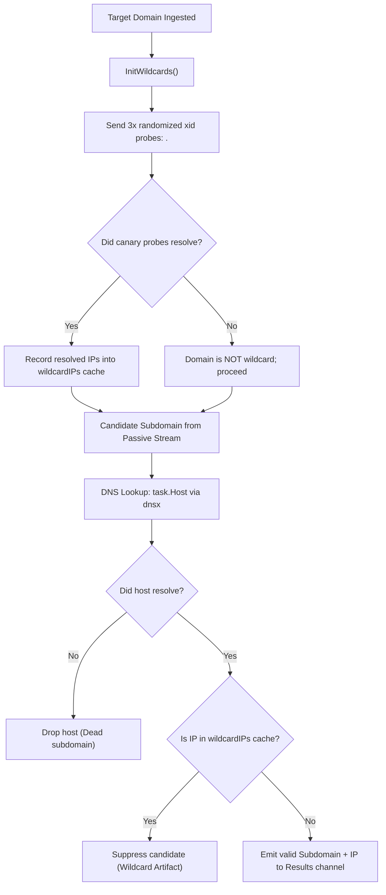

# Module Plan: `pkg/resolve`

---

## 1. Module Overview & Purpose

The `pkg/resolve` module is Subfinder's active DNS resolution and wildcard elimination engine. Its core responsibilities are:
1. **Canary-Based Wildcard Detection**: Emitting randomized subdomain queries (`xid.New().String()`) against target domains to identify wildcard DNS responses.
2. **Wildcard IP Footprint Suppression**: Caching resolving IPs from canary probes and suppressing any candidate subdomain resolving to these sinkhole IPs.
3. **High-Performance DNS Client Wrapper**: Wrapping ProjectDiscovery's `dnsx` engine with curated global default public resolvers (Cloudflare, Google, Quad9, Yandex, OpenDNS).
4. **Concurrency Slot Throttling**: Implementing `lookupSlots` channel-based capacity bounding so that multiple concurrent domain enumeration pools share a global DNS query threshold without thread exhaustion.

---

## 2. File Structure

```
pkg/resolve/
├── client.go               # Resolver struct, DefaultResolvers, lookup concurrency throttling
├── concurrency_test.go     # Concurrency tests for bounded DNS lookup dispatching
├── doc.go                  # Go package documentation
└── resolve.go              # ResolutionPool, canary xid probe generation, wildcard suppression
```

---

## 3. Core Data Structures & Source Code

### 3.1 `Resolver` Struct & Default Resolvers ([`pkg/resolve/client.go`](file:///home/pwnbox/Desktop/code_projects/sectools/subfinder/pkg/resolve/client.go#L9-L28))

```go
// DefaultResolvers contains the default list of resolvers known to be good
var DefaultResolvers = []string{
	"1.1.1.1:53",        // Cloudflare primary
	"1.0.0.1:53",        // Cloudflare secondary
	"8.8.8.8:53",        // Google primary
	"8.8.4.4:53",        // Google secondary
	"9.9.9.9:53",        // Quad9 Primary
	"9.9.9.10:53",       // Quad9 Secondary
	"77.88.8.8:53",      // Yandex Primary
	"77.88.8.1:53",      // Yandex Secondary
	"208.67.222.222:53", // OpenDNS Primary
	"208.67.220.220:53", // OpenDNS Secondary
}

// Resolver is a struct for resolving DNS names
type Resolver struct {
	DNSClient   *dnsx.DNSX
	Resolvers   []string
	lookupSlots chan struct{}
}
```

---

### 3.2 Concurrency Slot Allocation: `WithConcurrencyLimit` ([`pkg/resolve/client.go`](file:///home/pwnbox/Desktop/code_projects/sectools/subfinder/pkg/resolve/client.go#L30-L75))

Binds active resolution concurrency to prevent DNS socket flood:

```go
func (r *Resolver) WithConcurrencyLimit(limit int) *Resolver {
	if limit < 1 {
		limit = 1
	}

	bounded := *r
	bounded.lookupSlots = make(chan struct{}, limit)
	return &bounded
}

func (r *Resolver) lookup(ctx context.Context, host string) ([]string, error) {
	if err := r.acquire(ctx); err != nil {
		return nil, err
	}

	if r.lookupSlots != nil {
		defer func() { <-r.lookupSlots }()
	}

	if err := ctx.Err(); err != nil {
		return nil, err
	}

	return r.DNSClient.Lookup(host)
}

func (r *Resolver) acquire(ctx context.Context) error {
	if err := ctx.Err(); err != nil {
		return err
	}

	if r.lookupSlots == nil {
		return nil
	}

	select {
	case r.lookupSlots <- struct{}{}:
		return nil
	case <-ctx.Done():
		return ctx.Err()
	}
}
```

---

### 3.3 `ResolutionPool` & Wildcard Detection ([`pkg/resolve/resolve.go`](file:///home/pwnbox/Desktop/code_projects/sectools/subfinder/pkg/resolve/resolve.go#L17-L112))

```go
const maxWildcardChecks = 3

// ResolutionPool is a pool of resolvers created for resolving subdomains
type ResolutionPool struct {
	*Resolver
	Tasks          chan HostEntry
	Results        chan Result
	wg             *sync.WaitGroup
	removeWildcard bool
	ctx            context.Context

	wildcardIPs map[string]struct{}
}

// HostEntry defines a host with the source
type HostEntry struct {
	Domain              string
	Host                string
	Source              string
	WildcardCertificate bool
}

// Result contains the result for a host resolution
type Result struct {
	Type                ResultType
	Host                string
	IP                  string
	Error               error
	Source              string
	WildcardCertificate bool
}

// InitWildcards probes for wildcard DNS via randomized xid prefixes
func (r *ResolutionPool) InitWildcards(domain string) error {
	for range maxWildcardChecks {
		uid := xid.New().String()

		hosts, _ := r.lookup(r.ctx, uid+"."+domain)
		if err := r.ctx.Err(); err != nil {
			return err
		}

		if len(hosts) == 0 {
			return fmt.Errorf("%s is not a wildcard domain", domain)
		}

		// Append all wildcard ips found for domain
		for _, host := range hosts {
			r.wildcardIPs[host] = struct{}{}
		}
	}

	return nil
}
```

---

### 3.4 Worker Resolution & Wildcard Suppression: `resolveTask` ([`pkg/resolve/resolve.go`](file:///home/pwnbox/Desktop/code_projects/sectools/subfinder/pkg/resolve/resolve.go#L177-L224))

```go
func (r *ResolutionPool) resolveTask(task HostEntry) {
	if r.ctx.Err() != nil {
		return
	}

	if !r.removeWildcard {
		r.sendResult(Result{Type: Subdomain, Host: task.Host, IP: "", Source: task.Source, WildcardCertificate: task.WildcardCertificate})
		return
	}

	hosts, err := r.DNSClient.Lookup(task.Host)
	if err != nil {
		r.sendResult(Result{Type: Error, Host: task.Host, Source: task.Source, Error: err, WildcardCertificate: task.WildcardCertificate})
		return
	}

	if len(hosts) == 0 {
		return
	}

	var skip bool
	for _, host := range hosts {
		// Suppress host if its resolved IP exists in the wildcard IPs map
		if _, ok := r.wildcardIPs[host]; ok {
			skip = true
			break
		}
	}

	if !skip {
		r.sendResult(Result{Type: Subdomain, Host: task.Host, IP: hosts[0], Source: task.Source, WildcardCertificate: task.WildcardCertificate})
	}
}

func (r *ResolutionPool) sendResult(result Result) {
	if r.ctx.Err() != nil {
		return
	}

	select {
	case r.Results <- result:
	case <-r.ctx.Done():
	}
}
```

---

## 4. Working Process Flow


