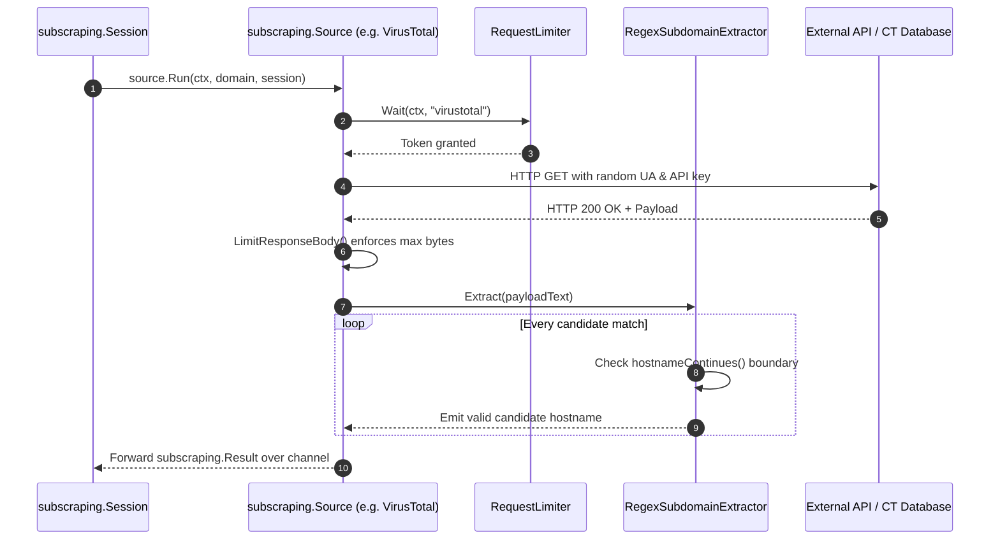

# Module Plan: `pkg/subscraping`

---

## 1. Module Overview & Purpose

The `pkg/subscraping` module is Subfinder's core passive scraping engine and data provider framework. It provides:
1. **The `Source` Interface Contract**: Standardizing how passive data sources authenticate, query upstream services, report runtime statistics, and emit discovered subdomains.
2. **HTTP Session Management (`Session`)**: Pooling TCP connections (`http.Transport`), rotating random `User-Agent` headers (`uarand`), supporting upstream HTTP/SOCKS proxies, and binding request pacing to the central rate limiter.
3. **Memory Safety & Body Protection (`LimitResponseBody`)**: Protecting against memory exhaustion and gzip decompression bombs by strictly bounding upstream HTTP response body reads via `io.LimitReader`.
4. **Subdomain Extraction & Security Suffix Analysis (`RegexSubdomainExtractor`)**: High-speed regex extraction equipped with trailing boundary analysis (`hostnameContinues`) to prevent cross-apex domain spoofing vulnerabilities.
5. **54 Passive Source Implementations**: Complete implementations across Certificate Transparency logs, OSINT feeds, threat intelligence databases, web archives, and search engines.

---

## 2. File Structure

```
pkg/subscraping/
├── agent.go                # HTTP Client wrapper, random User-Agent injection, LimitResponseBody
├── doc.go                  # Go package documentation
├── extractor.go            # RegexSubdomainExtractor, boundary check hostnameContinues
├── types.go                # Source interface, Session struct, KeyRequirement, Result
├── utils.go                # PickRandom API key helper
├── agent_connection_test.go# Tests for HTTP transport connection pooling
├── agent_test.go           # Unit tests for session requests and headers
├── discard_test.go         # Tests for HTTP response body discarding
├── extractor_test.go       # Tests for subdomain extraction and trailing boundary security
└── sources/                # 54 concrete source packages
    ├── alienvault/         # OTX API integration
    ├── censys/             # Censys search v2 integration
    ├── crtsh/              # Direct PostgreSQL (5432) + HTTP fallback
    ├── github/             # GitHub code search scraper
    ├── virustotal/         # VirusTotal v3 cursor paginating API
    └── ... (50 additional sources)
```

---

## 3. Core Data Structures & Source Code

### 3.1 `Source` & `Session` Interfaces ([`pkg/subscraping/types.go`](file:///home/pwnbox/Desktop/code_projects/sectools/subfinder/pkg/subscraping/types.go#L38-L113))

```go
// KeyRequirement represents the API key requirement level for a source
type KeyRequirement int

const (
	NoKey KeyRequirement = iota
	OptionalKey
	RequiredKey
)

// Source is an interface inherited by each passive source
type Source interface {
	Run(context.Context, string, *Session) <-chan Result
	Name() string
	IsDefault() bool
	HasRecursiveSupport() bool
	KeyRequirement() KeyRequirement
	NeedsKey() bool
	AddApiKeys([]string)
	Statistics() Statistics
}

// SubdomainExtractor defines the contract for extracting candidate subdomains from text
type SubdomainExtractor interface {
	Extract(text string) []string
}

// RequestLimiter waits for permission to send a source request
type RequestLimiter interface {
	Wait(context.Context, string) error
}

// Session is the option context uniquely created for each scraping source
type Session struct {
	Extractor           SubdomainExtractor
	Client              *http.Client
	MultiRateLimiter    *ratelimit.MultiLimiter
	RequestLimiter      RequestLimiter
	Timeout             int
	MaxResults          int
	MaxResponseBodySize int64
}

// Result is the result structure streamed by a source
type Result struct {
	Type   ResultType
	Source string
	Value  string
	Error  error
}
```

---

### 3.2 HTTP Client Session & Memory Safety Capping ([`pkg/subscraping/agent.go`](file:///home/pwnbox/Desktop/code_projects/sectools/subfinder/pkg/subscraping/agent.go#L20-L144))

```go
type limitedResponseBody struct {
	io.Reader // io.LimitReader over the original body
	io.Closer // the original body's Close
}

// LimitResponseBody caps response.Body at maxSize bytes in place
func LimitResponseBody(response *http.Response, maxSize int64) {
	if response == nil || response.Body == nil || maxSize <= 0 {
		return
	}
	response.Body = &limitedResponseBody{
		Reader: io.LimitReader(response.Body, maxSize),
		Closer: response.Body,
	}
}

func (s *Session) HTTPRequest(ctx context.Context, method, requestURL, cookies string, headers map[string]string, body io.Reader, basicAuth BasicAuth) (*http.Response, error) {
	req, err := http.NewRequestWithContext(ctx, method, requestURL, body)
	if err != nil {
		return nil, err
	}

	// Rotate randomized User-Agent
	req.Header.Set("User-Agent", uarand.GetRandom())
	req.Header.Set("Accept", "*/*")
	req.Header.Set("Accept-Language", "en")

	if basicAuth.Username != "" || basicAuth.Password != "" {
		req.SetBasicAuth(basicAuth.Username, basicAuth.Password)
	}

	if cookies != "" {
		req.Header.Set("Cookie", cookies)
	}

	for key, value := range headers {
		req.Header.Set(key, value)
	}

	sourceName := ctx.Value(CtxSourceArg).(string)

	// Acquire rate limit slot
	var mrlErr error
	if s.RequestLimiter != nil {
		mrlErr = s.RequestLimiter.Wait(ctx, sourceName)
	} else {
		mrlErr = s.MultiRateLimiter.Take(sourceName)
	}

	if mrlErr != nil {
		return nil, mrlErr
	}

	return httpRequestWrapper(s.Client, req, s.MaxResponseBodySize)
}
```

---

### 3.3 Subdomain Regex Extractor & Boundary Security ([`pkg/subscraping/extractor.go`](file:///home/pwnbox/Desktop/code_projects/sectools/subfinder/pkg/subscraping/extractor.go#L8-L70))

Prevents cross-apex domain spoofing (e.g., extracting `target.com` from `target.com.attacker.org`):

```go
type RegexSubdomainExtractor struct {
	extractor *regexp.Regexp
}

func NewSubdomainExtractor(domain string) (*RegexSubdomainExtractor, error) {
	// QuoteMeta escapes dots so "example.com" does not match "exampleXcom"
	extractor, err := regexp.Compile(`(?i)[a-zA-Z0-9\*_.-]+\.` + regexp.QuoteMeta(domain))
	if err != nil {
		return nil, err
	}
	return &RegexSubdomainExtractor{extractor: extractor}, nil
}

func (re *RegexSubdomainExtractor) Extract(text string) []string {
	indices := re.extractor.FindAllStringIndex(text, -1)
	matches := make([]string, 0, len(indices))
	for _, idx := range indices {
		// Drop matches that are prefixes of longer domains (e.g. foo.example.com.evil.org)
		if hostnameContinues(text, idx[1]) {
			continue
		}
		matches = append(matches, strings.Clone(strings.ToLower(text[idx[0]:idx[1]])))
	}
	return matches
}

func hostnameContinues(text string, end int) bool {
	if end >= len(text) {
		return false
	}
	b := text[end]
	if isLabelByte(b) {
		return true
	}
	if b == '.' {
		return end+1 < len(text) && isLabelStart(text[end+1])
	}
	return false
}

func isLabelByte(b byte) bool {
	return isLabelStart(b) || b == '-' || b == '_'
}

func isLabelStart(b byte) bool {
	return b >= 'a' && b <= 'z' || b >= 'A' && b <= 'Z' || b >= '0' && b <= '9'
}
```

---

### 3.4 Concrete Source Implementation 1: `crtsh` Direct PostgreSQL Query + HTTP Fallback ([`pkg/subscraping/sources/crtsh/crtsh.go`](file:///home/pwnbox/Desktop/code_projects/sectools/subfinder/pkg/subscraping/sources/crtsh/crtsh.go#L34-L100))

```go
func (s *Source) Run(ctx context.Context, domain string, session *subscraping.Session) <-chan subscraping.Result {
	results := make(chan subscraping.Result)

	go func() {
		var stats subscraping.Statistics
		defer func(startTime time.Time) {
			stats.TimeTaken = time.Since(startTime)
			s.mu.Lock()
			s.stats = stats
			s.mu.Unlock()
			close(results)
		}(time.Now())

		// Attempt direct high-speed PostgreSQL query first
		count := s.getSubdomainsFromSQL(ctx, domain, session, results, &stats)
		if count > 0 {
			return
		}
		// Fallback to HTTP JSON API if direct database connection fails
		_ = s.getSubdomainsFromHTTP(ctx, domain, session, results, &stats)
	}()

	return results
}

func (s *Source) getSubdomainsFromSQL(ctx context.Context, domain string, session *subscraping.Session, results chan subscraping.Result, stats *subscraping.Statistics) int {
	connStr := fmt.Sprintf("host=crt.sh user=guest dbname=certwatch sslmode=disable binary_parameters=yes connect_timeout=%d", session.Timeout)
	db, err := sql.Open("postgres", connStr)
	if err != nil {
		return 0
	}
	defer db.Close()

	conn, err := db.Conn(ctx)
	if err != nil {
		return 0
	}
	defer conn.Close()

	// Enforce strict statement timeout in database engine
	if _, err := conn.ExecContext(ctx, fmt.Sprintf("SET statement_timeout = %d;", session.Timeout*1000)); err != nil {
		return 0
	}

	query := fmt.Sprintf(`SELECT DISTINCT cai.NAME_VALUE
                          FROM certificate_and_identities cai
                          WHERE plainto_tsquery('certwatch', '%s') @@ identities(cai.CERTIFICATE)
                            AND cai.NAME_VALUE ILIKE ('%%.' || '%s')`, domain, domain)

	rows, err := conn.QueryContext(ctx, query)
	if err != nil {
		return 0
	}
	defer rows.Close()

	count := 0
	for rows.Next() {
		var nameValue string
		if err := rows.Scan(&nameValue); err == nil {
			for _, sub := range session.Extractor.Extract(nameValue) {
				results <- subscraping.Result{Source: s.Name(), Type: subscraping.Subdomain, Value: sub}
				count++
				stats.Results++
			}
		}
	}
	return count
}
```

---

### 3.5 Concrete Source Implementation 2: `virustotal` Cursor Pagination ([`pkg/subscraping/sources/virustotal/virustotal.go`](file:///home/pwnbox/Desktop/code_projects/sectools/subfinder/pkg/subscraping/sources/virustotal/virustotal.go#L37-L110))

```go
func (s *Source) Run(ctx context.Context, domain string, session *subscraping.Session) <-chan subscraping.Result {
	results := make(chan subscraping.Result)
	s.mu.Lock()
	apiKeys := s.apiKeys
	s.mu.Unlock()

	go func() {
		var stats subscraping.Statistics
		defer func(startTime time.Time) {
			stats.TimeTaken = time.Since(startTime)
			s.mu.Lock()
			s.stats = stats
			s.mu.Unlock()
			close(results)
		}(time.Now())

		randomApiKey := subscraping.PickRandom(apiKeys, s.Name())
		if randomApiKey == "" {
			return
		}

		var cursor = ""
		for {
			select {
			case <-ctx.Done():
				return
			default:
			}

			url := fmt.Sprintf("https://www.virustotal.com/api/v3/domains/%s/subdomains?limit=40", domain)
			if cursor != "" {
				url = fmt.Sprintf("%s&cursor=%s", url, cursor)
			}
			stats.Requests++

			resp, err := session.Get(ctx, url, "", map[string]string{"x-apikey": randomApiKey})
			if err != nil {
				if resp != nil && resp.StatusCode == http.StatusTooManyRequests {
					err = fmt.Errorf("virustotal quota exhausted (HTTP 429); some subdomains for %s may be missing", domain)
				}
				results <- subscraping.Result{Source: s.Name(), Type: subscraping.Error, Error: err}
				stats.Errors++
				session.DiscardHTTPResponse(resp)
				return
			}

			var data response
			err = jsoniter.NewDecoder(resp.Body).Decode(&data)
			resp.Body.Close()

			if err != nil {
				results <- subscraping.Result{Source: s.Name(), Type: subscraping.Error, Error: err}
				stats.Errors++
				return
			}

			for _, object := range data.Data {
				for _, sub := range session.Extractor.Extract(object.Id) {
					results <- subscraping.Result{Source: s.Name(), Type: subscraping.Subdomain, Value: sub}
					stats.Results++
				}
			}

			// Handle cursor pagination termination
			if data.Meta.Cursor == "" || (session.MaxResults > 0 && stats.Results >= session.MaxResults) {
				return
			}
			cursor = data.Meta.Cursor
		}
	}()

	return results
}
```

---

## 4. Working Process Flow


